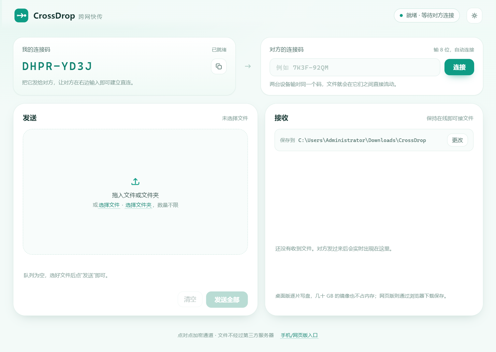
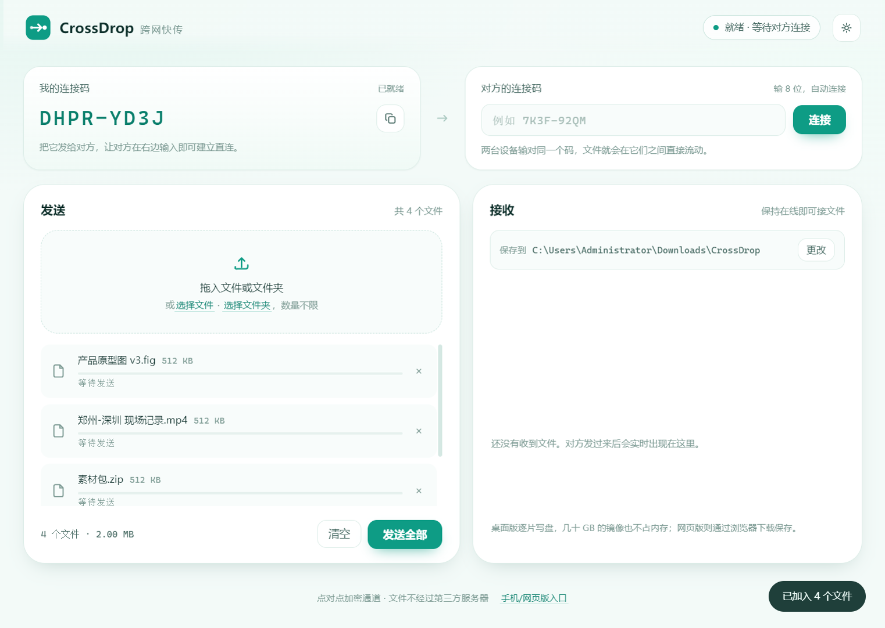

# CrossDrop 跨网快传

在两台电脑、或电脑与手机之间**跨局域网、跨地区**直接互传文件。

不需要同一个 Wi-Fi，不需要公网 IP，不需要注册账号：一方显示 8 位连接码，另一方输入这个码，文件就在两台设备之间通过加密的 WebRTC 通道直接流动——文件本身不经过任何中转服务器落盘。





```
  电脑 A (郑州 · 家宽)                电脑 B (深圳 · 公司网)
  ┌──────────────┐                  ┌──────────────┐
  │  连接码 7K3F-92QM │ ──信令握手──▶ │  输入 7K3F-92QM │
  └──────┬───────┘                  └───────┬──────┘
         └──────── WebRTC 加密通道 ────────┘
                 （直连，必要时自动走中继）
```

## 功能

- **跨网直连**：WebRTC NAT 打洞，短距离/跨省都能连；打洞失败时自动尝试 TURN 中继。
- **端到端加密**：数据通道为 DTLS 加密，文件内容只存在于两端设备。
- **8 位连接码配对**：无账号、无登录，输一次码即建立会话。
- **桌面端任意大小文件**：边收边写盘，不占内存，几十 GB 的镜像也能传。
- **多文件 / 整文件夹队列**：拖拽或选择，逐个发送，带单个与整体进度、实时速度。
- **接收目录自定义**：默认在「下载/CrossDrop」，可随时更改；收到的文件可一键打开所在文件夹。
- **断线与重连提示**：信令断开自动重建，连接状态、走直连还是中继一目了然。
- **手机也能用**：同一套界面提供网页版，安卓/iOS 浏览器打开即可收文件（见下文）。
- **干净的安装与卸载**：安装程序支持自定义安装路径；卸载会清空安装目录。

## 安装

1. 打开 [Releases](https://github.com/zgs7157/crossdrop/releases) 下载 `CrossDrop-Setup-1.0.0.exe`（Windows x64，未签名）。
2. 双击运行，选择安装路径（默认 `%LOCALAPPDATA%\Programs\CrossDrop`），点「安装」，没有下一步向导、没有捆绑项。
3. 安装完成后桌面与开始菜单会出现「CrossDrop 跨网快传」。

卸载：开始菜单 → 右键「CrossDrop 跨网快传」→ 卸载（或「设置 → 应用」里卸载）。卸载程序会把整个安装目录连同 `%APPDATA%\CrossDrop`（设置文件）一起删干净，不留残余。

也可以从源码自己构建：

```powershell
npm install
npm run dist      # 先由 scripts/prepare-assets.js 准备图标与前端库，再打包
```

产物是 `dist\CrossDrop-Setup-1.0.0.exe`。

> 安装包未做代码签名，Windows SmartScreen 可能提示「未知发布者」，选择「更多信息 → 仍要运行」即可；源码在本仓库可自行核对、自行构建。

## 使用

**两台电脑互传**

1. 两台电脑都安装并打开 CrossDrop。
2. A 端看「我的连接码」，例如 `7K3F-92QM`，把它发给对方（微信、QQ、口头都行）。
3. B 端在「对方的连接码」输入这 8 位，输入完会自动连接。
4. 连接成功后，A 端把文件或文件夹拖进左侧「发送」区，点「发送全部」。
5. B 端文件实时出现在「接收」列表，收完点文件夹图标即可打开所在目录。

**手机 ↔ 电脑**

手机不需要装 App：用手机浏览器打开网页版 <https://zgs7157.github.io/crossdrop/>，
在网页里输入电脑上显示的连接码，即可收/发文件。电脑端点左下角「手机/网页版入口」会把这个地址复制到剪贴板，直接发到手机即可。

> 网页版收到的文件走浏览器下载，超大文件受浏览器内存限制；电脑端没有这个限制。

## 连接原理与网络说明

| 环节 | 说明 |
| --- | --- |
| 直连 | WebRTC DataChannel 点对点，浏览器/Electron 内置 DTLS 加密，文件不经过服务器 |
| 打洞 | 内置 STUN（Cloudflare / Google / Nextcloud），只用来互报公网地址 |
| 跨网兜底 | 项目自带 `server/` 自建服务（信令 + 中继二合一），双方在网络都很严格时由它转发，不依赖任何第三方云 |
| 工作方式 | 「先直连，4 秒连不上自动走自建中继」，界面会显示「点对点直连」或「经自建中继转发」 |

> 1.0.1 起移除了失效的公共免费 TURN：那些服务早已不出 relay 候选，只会拖慢握手并造成「同局域网能传、跨局域网连不上」。跨网稳定性改由自建服务保证。

设置项在右上角「设置」：自建服务地址与口令、连接方式（auto / 只走中继 / 只直连）、STUN/TURN、接收目录。

## 常见问题

- **跨局域网连不上（同局域网正常）**：双方都在 NAT 后面，直连打洞失败。在设置里填自建服务地址（见下一节），客户端会自动改走中继。
- **一直显示「正在连接信令服务」**：当前网络访问不了 `0.peerjs.com`。把连接方式改成「只走自建服务」即可完全不依赖公共信令。
- **输入码后提示「对方不在线」**：对方的 CrossDrop 没开，或码输错了（码里不会出现 0、1、I、O）；走中继时还要确认双方填的是同一个服务地址和口令。
- **连上了但很慢**：看界面显示的是「点对点直连」还是「经自建中继转发」。中继受服务器带宽限制，直连通常更快。
- **传输中断**：网络切换或对方关闭应用会断开；重新连接后可重发（暂不支持断点续传）。
- **防火墙提示**：允许 CrossDrop 通过防火墙，直连成功率更高。

## 自建服务（信令 + 中继，跨网推荐）

`server/` 里的服务只需要 Node.js 18+ 和一个 `ws` 依赖，不依赖 PeerJS 云、不依赖任何公共 TURN：

```bash
cd server && npm install && npm start          # 默认 9000 端口
# 或带口令与自定义端口
node index.js --port 9000 --token 你的口令
```

- 手机上/另一台电脑上打开 `http://服务器地址:9000/health`，看到 `{"ok":true,...}` 说明服务正常。
- CrossDrop 设置里「自建服务地址」填 `ws://服务器地址:9000/ws`，口令填一致的值，连接方式选「先直连，连不上自动走中继」。
- 放在公网请务必加 `--token`；想走 `wss://` 就在 Nginx 上做 443 → 9000 的反代并配证书。
- 服务端只需要一个可被双方访问的地址：有公网 IP 的 VPS、家里宽带的 IPv6、或者任意一台双方都能连到的机器都行。

### 可选：自建 TURN

如果不想用本项目的 WebSocket 中继，也可以自己搭 coturn（`turn:` 协议，与 WebRTC 原生配合）：

```bash
turnserver -a -f -n -r crossdrop -u crossdrop:yourpassword \
  --listening-port 3478 --min-port 49152 --max-port 65535
```

然后把 `turn:your-host:3478`、用户名、密码填进设置的 TURN 项。

## 开发

需要 Node.js 18+。

```bash
npm install          # 安装依赖（peerjs、ws、electron、electron-builder）
npm start            # 启动桌面版
npm run server       # 启动自建信令 + 中继服务（默认 9000 端口）
npm run test:e2e     # 端到端自测：两个窗口真实互传 8MB 文件并校验内容哈希（直连）
electron scripts/e2e-relay.js   # 中继链路自测（脚本内自动起服务）
npm run assets       # 重新生成图标、从 node_modules 复制 peerjs.min.js
npm run dist         # 打包 Windows 安装程序，产物在 dist/
```

网页版不需要构建：`src/` 目录本身就是可以直接放到任意静态托管上的文件，仓库里的 `.github/workflows/pages.yml` 会在每次 push 时把它发布到 GitHub Pages（仓库 Settings → Pages 里把 Source 选成「GitHub Actions」即可启用）。

国内网络可用镜像加速依赖与 Electron 下载：

```powershell
$env:ELECTRON_MIRROR='https://npmmirror.com/mirrors/electron/'
$env:ELECTRON_BUILDER_BINARIES_MIRROR='https://npmmirror.com/mirrors/electron-builder-binaries/'
npm install
```

## 目录结构

```
electron/         主进程：窗口、设置存储、接收文件落盘、IPC
  main.js
  preload.js      仅暴露必要 API（contextIsolation + sandbox）
src/              渲染层（桌面端与网页版共用同一套代码）
  index.html
  styles.css
  app.js          界面与状态
  transfer.js     配对、数据通道、分片文件协议、直连失败转中继
  relay-link.js   自建服务通道（WebSocket → 与 DataConnection 同形）
  platform.js     桌面/浏览器能力适配（保存方式、设置存储）
  vendor/         第三方前端库（peerjs.min.js，MIT）
server/           自建服务：信令 + 中继二合一（Node + ws，可独立部署）
build/            图标（由 scripts/make-icon.js 用代码绘制）与 NSIS 卸载脚本
scripts/          端到端测试、截图、图标与资源准备
```

## 协议（文件分片）

1. 控制消息走 JSON 字符串：`hello` / `fs`(file start) / `fe`(file end) / `cxl` / `done`。
2. 文件内容按 64 KB 分片以二进制发送，发送端按 `bufferedAmount` 做背压，不撑爆内存。
3. 接收端桌面版逐片写盘（IPC 顺序写入），网页版累积后触发浏览器下载。
4. 文件夹发送时附带相对路径，桌面端会按目录还原结构。

## 已知限制

- 同一时间只支持 1 对连接（一个发送方 ↔ 一个接收方）。
- 不支持断点续传、不支持多路并发传输。
- 网页版接收超大文件受浏览器内存限制（桌面版无此限制）。
- 传输速度取决于两端带宽与 NAT 路径，跨省家宽通常在 1–10 MB/s；走中继时速度受服务器带宽限制。
- 跨网「一定能连上」的前提是：能打洞成功，或者有一个双方都能访问的自建服务。没有任何中继服务器时，严格 NAT 之间无法直连，这是网络层限制，不是客户端能绕过的。

## 许可

MIT © 2026 zgs7157

第三方依赖：[PeerJS](https://github.com/peers/peerjs)（MIT）、[ws](https://github.com/websockets/ws)（MIT）、[Electron](https://www.electronjs.org/)（MIT）、[electron-builder](https://www.electron.build/)（MIT）。
